# Cake Delight

A cloud-native cake shop built from independently deployable Spring Boot microservices. Customers browse and filter cakes, manage a basket, check out, rate cakes and receive an order confirmation. The services communicate over REST and RabbitMQ, run in Docker containers and are deployed to Kubernetes.

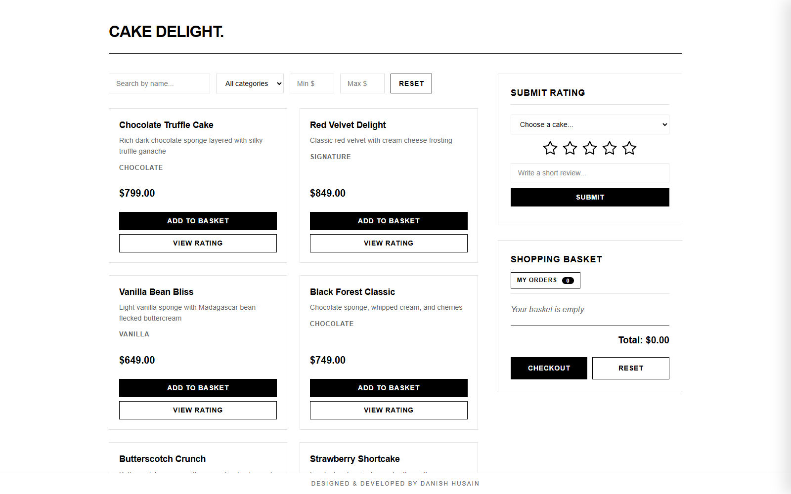

## Table of contents

1. [About this repository](#about-this-repository)
2. [Problem statement](#problem-statement)
3. [How the solution meets the requirements](#how-the-solution-meets-the-requirements)
4. [Architecture](#architecture)
5. [Repository structure](#repository-structure)
6. [Running the project locally](#running-the-project-locally)
    - [Prerequisites](#1-prerequisites)
    - [Option A: Docker Compose](#2-option-a-docker-compose-quickest)
    - [Option B: Kubernetes on Docker Desktop](#3-option-b-kubernetes-on-docker-desktop)
7. [End-to-end walkthrough](#end-to-end-walkthrough)
8. [Tests](#tests)
9. [Monitoring and operations](#monitoring-and-operations)
10. [Autoscaling](#autoscaling)
11. [Troubleshooting](#troubleshooting)
12. [Design decisions and limitations](#design-decisions-and-limitations)
13. [Further documentation](#further-documentation)

---

## About this repository

I built this project as the capstone of a cloud-native application development training program at my organization. The program asks every participant to design, build, containerize and deploy the same application, Cake Delight, from the problem statement below.

I am publishing it so that future participants have a complete, working reference: how the services can be split, how they talk to each other, how the Docker and Kubernetes pieces fit together, and how to run everything on a laptop. Use it to understand the concepts and to get unstuck, then build your own solution; that is where the learning happens.

---

## Problem statement

> The problem statement is reproduced as it was given, with formatting adjusted for Markdown.

### Introduction

The Capstone Project focuses on developing a cloud-native microservices application named Cake Delight. The project is intended to provide hands-on experience in designing, developing, containerizing, deploying, and managing independently deployable services in a cloud-native environment.

Through this project, participants will learn by building a practical application that reflects real-world engineering concerns such as service ownership, loose coupling, scalability, fault tolerance, observability, and deployment automation.

### Problem statement

Design and develop a cloud-native application named Cake Delight using a microservices-based architecture. The application should deliver an end-to-end customer journey that allows users to browse cake products, apply filters, add items to a basket, modify basket contents, complete checkout, rate purchased cakes, and receive order confirmation notifications.

The solution must demonstrate cloud-native engineering principles including independent service deployment, API-based communication, event-driven notifications, containerized execution, database-backed persistence, and Kubernetes-based orchestration.

### Project objectives

By completing this capstone project, participants should be able to:

- Implement business capabilities using a microservices architecture.
- Design service boundaries for catalog, order, rating, and notification capabilities.
- Enable service-to-service communication through REST APIs and/or messaging.
- Use containerization to package and run application services consistently.
- Deploy and manage services using Kubernetes.
- Apply scalability, resilience, and maintainability practices in application design.

### Technology stack

Participants may use the following technology stack to implement the solution:

- **Microservices framework:** Spring Boot or Node.js
- **Containerization:** Docker
- **Orchestration:** Kubernetes
- **Communication:** REST APIs and/or message broker
- **Supporting components:** API Gateway, database services, and notification mechanism
- **Core services:** Cake Catalog, Order, Rating, and Notification

### Functional scope

The Cake Delight application should support the following functional capabilities:

- Browse available cakes in the catalog.
- Filter cakes by attributes such as name, category, and price range.
- Add selected cakes to the shopping basket.
- View, update, and remove items from the basket.
- Complete checkout and create an order.
- Submit ratings for cake items.
- Send order confirmation notifications after successful checkout.

### Microservices design

**Cake Catalog Microservice**

- Maintain cake product information such as name, description, category, price, availability, and image reference.
- Provide APIs to list cakes and retrieve details of a selected cake.
- Support filtering by product name, category, and price range.

**Order Microservice**

- Manage basket operations such as adding, updating, and removing cake items.
- Display basket contents and calculate order totals.
- Create orders during checkout and maintain order status.
- Publish an order completion event after successful checkout.

**Rating Microservice**

- Allow users to submit ratings for cake items.
- Store and retrieve ratings for individual products.
- Expose APIs to calculate and display average ratings.

**Notification Microservice**

- Listen for order completion events from the Order Microservice.
- Send order confirmation through email, SMS, or in-app notification.
- Maintain notification delivery status where applicable.

### Architecture overview

The solution should follow a microservices architecture where the API Gateway acts as the single entry point for client requests. Each microservice should own its business capability and data persistence mechanism. Services may communicate synchronously using APIs and asynchronously using events or messages.

Key architecture components:

- Client application or user interface
- API Gateway
- Cake Catalog Microservice
- Order Microservice
- Rating Microservice
- Notification Microservice
- Databases owned by respective services
- Message broker for event-driven communication

Architecture characteristics:

- Each service should be independently buildable, deployable, and scalable.
- Services should interact through clearly defined APIs or messaging contracts.
- The application should be containerized using Docker.
- Deployment, scaling, and service discovery should be handled through Kubernetes.
- The design should consider fault tolerance, retries, logging, and basic monitoring.

### Expected deliverables

- Source code for all implemented microservices.
- API documentation for exposed endpoints.
- Docker files for each service.
- Kubernetes deployment and service configuration files.
- Database schema or data model for applicable services.
- Message/event contract for order completion notifications.
- Setup and execution instructions.
- Short demonstration of the end-to-end application flow.

### Evaluation criteria

| Evaluation area | Expected focus |
|---|---|
| Microservices Design | Clear service boundaries, independent ownership, and loose coupling. |
| Design API Implementation | Well-defined endpoints, request/response handling, and validation. |
| Event Handling | Order completion event flow and notification processing. |
| Containerization | Correct Docker packaging and service execution. |
| Kubernetes Deployment | Deployment files, services, configuration, and scalability readiness. |
| Reliability and Maintainability | Error handling, logging, basic monitoring, and clean code structure. |
| End-to-End Demo | Successful demonstration of browsing, basket, checkout, rating, and notification flow. |

### Conclusion

The Cake Delight capstone project provides participants with practical exposure to building a real-world cloud-native microservices system. By completing this project, learners will demonstrate their ability to design scalable services, integrate APIs and events, containerize applications, deploy workloads on Kubernetes, and deliver an end-to-end business workflow.

---

## How the solution meets the requirements

| Requirement | Implementation |
|---|---|
| Browse the catalog, view a cake | `GET /api/catalog`, `GET /api/catalog/{id}` in cake-catalog-service |
| Filter by name, category, price range | `GET /api/catalog?name=&category=&minPrice=&maxPrice=` (any combination), plus single-filter endpoints |
| Add, view, update and remove basket items | order-service basket endpoints; the basket is stored server-side as a `PENDING` order |
| Calculate totals | Always calculated by order-service from the catalog price, never taken from the client |
| Checkout, order status | `POST /api/orders/{id}/checkout` moves the order from `PENDING` to `COMPLETED` |
| Publish an order completion event | order-service publishes `OrderCompletedEvent` to RabbitMQ |
| Rate cakes, average rating | rating-service: submit a 1 to 5 score with an optional review; average and count computed by the database |
| Order confirmation notification | notification-service consumes the event and creates an in-app confirmation that the UI shows under "My Orders" |
| Notification delivery status | Each confirmation is stored with status `SENT` or `FAILED` |
| API Gateway as single entry point | Spring Cloud Gateway routes `/api/**` to the services |
| Database per service | One MySQL schema per service; no service reads another service's tables |
| Synchronous service-to-service calls | order-service and rating-service call cake-catalog-service over REST, resolved through Eureka |
| Asynchronous messaging | RabbitMQ direct exchange, durable queue and dead-letter queue |
| Containerization | Multi-stage Dockerfile per service, non-root runtime user |
| Kubernetes deployment, scaling, discovery | Deployments, Services, ConfigMap, Secrets, PersistentVolumeClaim, HorizontalPodAutoscalers, Kustomize |
| Fault tolerance and retries | Timeouts and retries on REST calls, gateway retries for GET requests, listener retries with dead-lettering, idempotent consumer, health probes |
| Logging and basic monitoring | Consistent SLF4J logging in every service, Spring Boot Actuator health and metrics, Eureka dashboard, RabbitMQ management UI |
| API documentation | [docs/API-DOCUMENTATION.md](docs/API-DOCUMENTATION.md) and a live Swagger UI on the gateway |
| Data model | [docs/DATABASE-SCHEMA.md](docs/DATABASE-SCHEMA.md) |
| Event contract | [docs/EVENT-CONTRACT.md](docs/EVENT-CONTRACT.md) |

---

## Architecture

| Component | Responsibility | Port |
|---|---|---|
| `frontend` | Single-page UI (HTML, CSS, JavaScript) served by nginx | 80 (published as 30000) |
| `api-gateway` | Single entry point; routes requests, retries, CORS, combined Swagger UI | 8080 (published as 30080) |
| `eureka-server` | Service registry used for discovery and client-side load balancing | 8761 |
| `cake-catalog-service` | Cake catalog and filtering | 8081 |
| `order-service` | Basket, checkout, publishes the order completion event | 8082 |
| `rating-service` | Ratings and averages | 8083 |
| `notification-service` | Consumes the event, stores and serves order confirmations | 8084 |
| `mysql` | One MySQL server, one database per service | 3306 |
| `rabbitmq` | Message broker for the order completion event | 5672, 15672 (UI) |

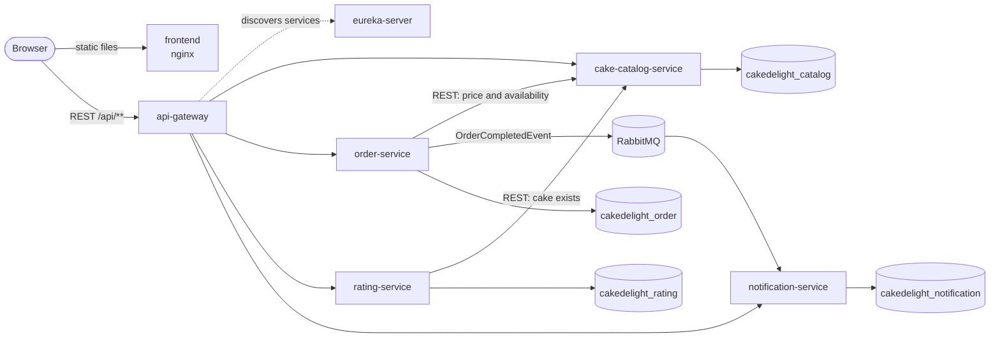

Every service registers itself with Eureka. The gateway and the services address each other by service name (for example `lb://order-service`), so instances can move, restart or scale without configuration changes.

### Technology

| Area | Choice |
|---|---|
| Language and runtime | Java 21 |
| Framework | Spring Boot 4.1, Spring Cloud 2025.1 (Gateway, Netflix Eureka, LoadBalancer) |
| Persistence | Spring Data JPA (Hibernate), MySQL 8.4 |
| Messaging | Spring AMQP, RabbitMQ 4 |
| API documentation | springdoc-openapi (Swagger UI) |
| Frontend | HTML, CSS and plain JavaScript on nginx |
| Containers and orchestration | Docker, Docker Compose, Kubernetes, Kustomize |
| Tests | JUnit 5, Mockito, Spring Boot Test, H2 |

---

## Repository structure

```
cake-delight/
├── api-gateway/               Spring Cloud Gateway: routing, retries, CORS, Swagger UI
├── eureka-server/             Service registry
├── cake-catalog-service/      Catalog REST API
├── order-service/             Basket and order REST API, RabbitMQ publisher
├── rating-service/            Rating REST API
├── notification-service/      RabbitMQ consumer and notification REST API
├── frontend/                  Static web UI served by nginx
├── k8s/                       Kubernetes manifests and kustomization.yaml
│   └── addons/                Optional extras (metrics-server patch)
├── docs/                      API, database and event documentation, screenshots
├── scripts/                   Helper scripts to build and push the Docker images
└── docker-compose.yml         Runs the whole stack on one machine
```

Each service is a standalone Maven project with its own `pom.xml`, Maven wrapper, `Dockerfile` and tests, so it can be built, tested and deployed independently of the others. Inside a service the code follows the usual layering: `controller` (HTTP), `service` (business rules), `repository` (database), `model` (entities), `dto` (request and response bodies), `client` (calls to other services), `config` and `exception`.

---

## Running the project locally

There are two ways to run the complete application:

- **Option A, Docker Compose:** one command, no Kubernetes needed. Best for trying the application and for development.
- **Option B, Kubernetes on Docker Desktop:** the deployment the problem statement asks for, including service discovery, health probes and autoscaling.

### 1. Prerequisites

| Tool | Needed for | Notes |
|---|---|---|
| [Docker Desktop](https://www.docker.com/products/docker-desktop/) | Both options | Give it at least **4 GB** of memory for Option A and **6 GB** for Option B (Settings, Resources). The stack runs seven JVMs. |
| Git | Both options | To clone the repository |
| Kubernetes in Docker Desktop and `kubectl` | Option B | `kubectl` is installed together with Docker Desktop |
| Java 21 | Only to run the tests outside Docker | Maven is not required; each service includes the Maven wrapper |

Clone the repository:

```bash
git clone https://github.com/danishxvi/cake-delight.git
cd cake-delight
```

Ports used on your machine: `30000` (website), `30080` (API Gateway), `8761` (Eureka), `15672` (RabbitMQ UI) and `3307` (MySQL, Option A). Stop anything else that uses them first.

### 2. Option A: Docker Compose (quickest)

Docker Compose builds every image from source (the Dockerfiles compile the code with Maven inside Docker, so Java is not needed on your machine) and starts the whole stack:

```bash
docker compose up --build -d
```

The first build downloads the Maven dependencies and takes several minutes. Later builds reuse the cache and are much faster.

Check the status:

```bash
docker compose ps
```

The Java services need one to three minutes to start and register with Eureka. The application is ready when this request returns the list of cakes:

```bash
curl http://localhost:30080/api/catalog
```

Then open:

| What | URL |
|---|---|
| Website | http://localhost:30000 |
| Swagger UI | http://localhost:30080/swagger-ui.html |
| Eureka dashboard | http://localhost:8761 |
| RabbitMQ management UI | http://localhost:15672 (user `cakeuser`, password `cakepass123`) |
| MySQL | `localhost:3307`, user `root`, password `root` |

Useful commands:

```bash
docker compose logs -f order-service           # follow the logs of one service
docker compose up -d --build order-service     # rebuild and restart one service after a code change
docker compose down                            # stop everything, keep the database
docker compose down -v                         # stop everything and delete the database
```

The catalog fills itself with eight sample cakes the first time cake-catalog-service starts with an empty database.

### 3. Option B: Kubernetes on Docker Desktop

#### 3.1 Enable Kubernetes

Open Docker Desktop, go to **Settings, Kubernetes**, turn on **Enable Kubernetes** and click **Apply**. The first start takes a few minutes.

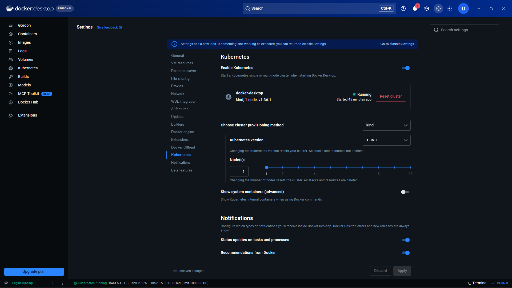

Point `kubectl` at the Docker Desktop cluster and check that the node is ready:

```bash
kubectl config use-context docker-desktop
kubectl get nodes
```

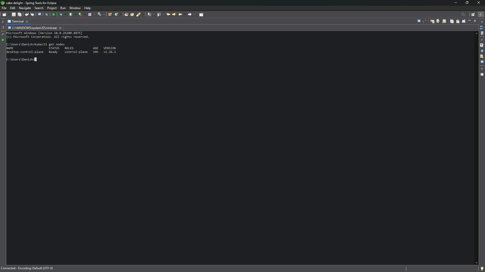

#### 3.2 Choose the container images

The Deployments in `k8s/` use images from Docker Hub under `danish1611/<service>:1.1.0`, so Kubernetes can pull them without any build step.

To run images built from your own copy of the code instead, build and push them to your Docker Hub account (run `docker login` first):

```bash
# macOS, Linux or Git Bash
scripts/build-images.sh <your-docker-hub-user> 1.1.0 --push
```

```powershell
# Windows PowerShell
.\scripts\build-images.ps1 -RegistryUser <your-docker-hub-user> -Tag 1.1.0 -Push
```

Then replace `danish1611` with your user in the `images:` section of [`k8s/kustomization.yaml`](k8s/kustomization.yaml). That one file controls the image of every Deployment.

#### 3.3 Deploy

```bash
kubectl apply -k k8s/
```

This creates the Secrets, ConfigMap, MySQL (with a persistent volume), RabbitMQ, Eureka, the gateway, the four services, the frontend, and the autoscalers in one step.

#### 3.4 Wait for the pods

```bash
kubectl get pods -w
```

Wait until all nine pods show `1/1` and `Running`, then press `Ctrl+C`. Pulling the images and starting the JVMs takes a few minutes the first time. The startup probes give each Java service up to five minutes before Kubernetes restarts it.

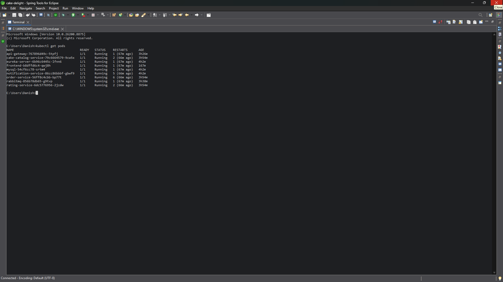

```
NAME                                    READY   STATUS    RESTARTS   AGE
api-gateway-xxxxxxxxxx-xxxxx            1/1     Running   0          3m
cake-catalog-service-xxxxxxxxxx-xxxxx   1/1     Running   0          3m
eureka-server-xxxxxxxxxx-xxxxx          1/1     Running   0          3m
frontend-xxxxxxxxxx-xxxxx               1/1     Running   0          3m
mysql-xxxxxxxxxx-xxxxx                  1/1     Running   0          3m
notification-service-xxxxxxxxxx-xxxxx   1/1     Running   0          3m
order-service-xxxxxxxxxx-xxxxx          1/1     Running   0          3m
rabbitmq-xxxxxxxxxx-xxxxx               1/1     Running   0          3m
rating-service-xxxxxxxxxx-xxxxx         1/1     Running   0          3m
```

If a pod does not reach `Running`, see [Troubleshooting](#troubleshooting).

#### 3.5 Access the application

`frontend-service` and `gateway-service` are `NodePort` Services on ports `30000` and `30080`. On a regular cluster you would open those ports on the node's address. Docker Desktop runs the cluster inside a virtual machine, and forwarding of `NodePort` traffic to `localhost` is not reliable in every setup. Use one of these two approaches.

**Port-forwarding (works everywhere).** Keep both commands running in two terminals while you use the site:

```bash
kubectl port-forward svc/frontend-service 30000:30000
```

```bash
kubectl port-forward svc/gateway-service 30080:30080
```

Each command prints `Forwarding from 127.0.0.1:<port>` and keeps running.

**LoadBalancer Services (no port-forward needed).** Docker Desktop publishes `LoadBalancer` Services on `localhost`, using the Service port (30000 and 30080 here). Change `type: NodePort` to `type: LoadBalancer` in `k8s/frontend-service.yaml` and `k8s/gateway-service.yaml`, then run `kubectl apply -k k8s/` again. After a few seconds `kubectl get svc` shows `localhost` as the external IP of both Services.

Then open:

| What | URL | Extra step |
|---|---|---|
| Website | http://localhost:30000 | |
| Swagger UI | http://localhost:30080/swagger-ui.html | |
| Eureka dashboard | http://localhost:8761 | `kubectl port-forward svc/eureka-service 8761:8761` |
| RabbitMQ management UI | http://localhost:15672 (`cakeuser` / `cakepass123`) | `kubectl port-forward svc/rabbitmq-service 15672:15672` |
| MySQL | `localhost:3307`, `root` / `root` | `kubectl port-forward svc/mysql-service 3307:3306` |

The browser calls the gateway on port 30080 of the same host that served the page, which is why both ports must be reachable.

#### 3.6 Stop and clean up

```bash
kubectl delete -k k8s/
```

This removes everything, including the MySQL volume and therefore all orders and ratings. To keep the data, delete only the Deployments you want to stop, for example `kubectl delete deployment order-service`, and run `kubectl apply -k k8s/` again later.

---

## End-to-end walkthrough

This sequence demonstrates the complete flow required by the problem statement. It works the same way on Docker Compose and on Kubernetes.

1. **Browse the catalog.** Open http://localhost:30000. The catalog is loaded through the gateway from cake-catalog-service. Coffee Walnut Cake is marked as unavailable and cannot be added to the basket.

2. **Filter.** Type part of a name, pick a category, or enter a minimum and maximum price. The filters combine, and each change sends one query to the catalog service.

   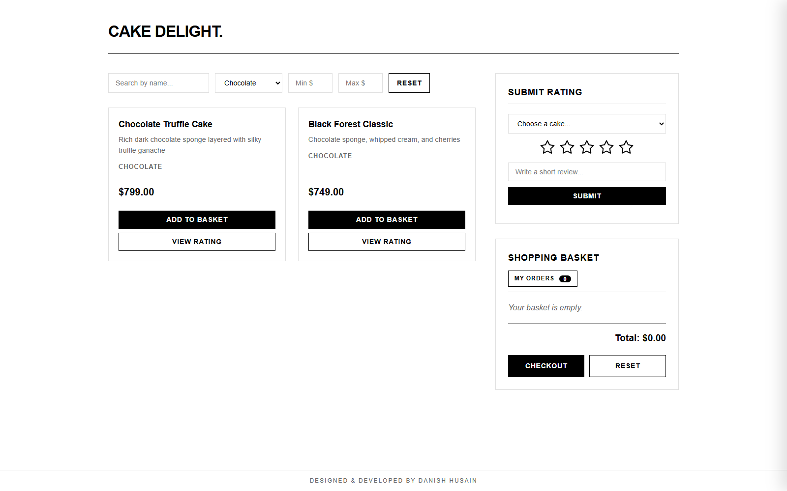

3. **Fill the basket.** Click **Add to Basket** on a few cakes and use **+** and **-** to change quantities. The basket lives in order-service: each change is an API call, and order-service fetches the name and price from the catalog service and recalculates the total.

   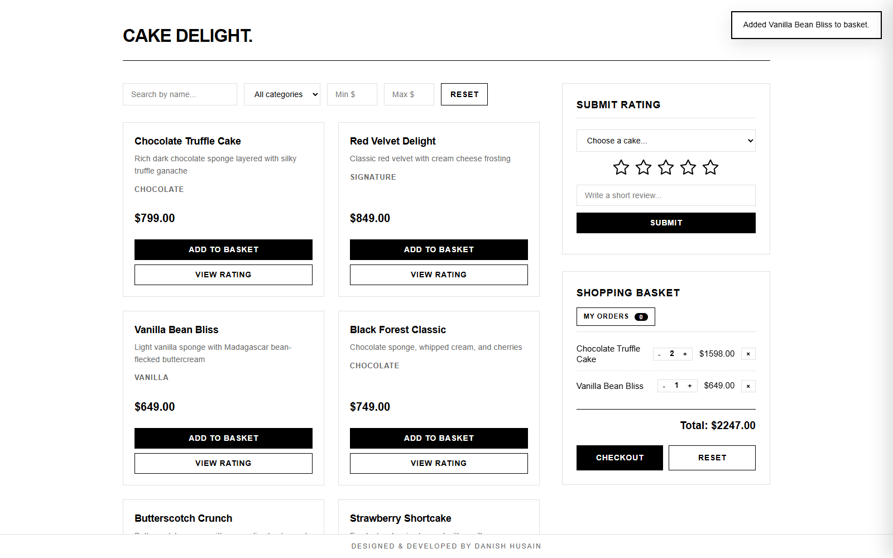

4. **Rate a cake.** Choose a cake in **Submit Rating**, pick a number of stars, optionally write a review, and submit. Then click **View Rating** on that cake to see the average and the number of ratings.

   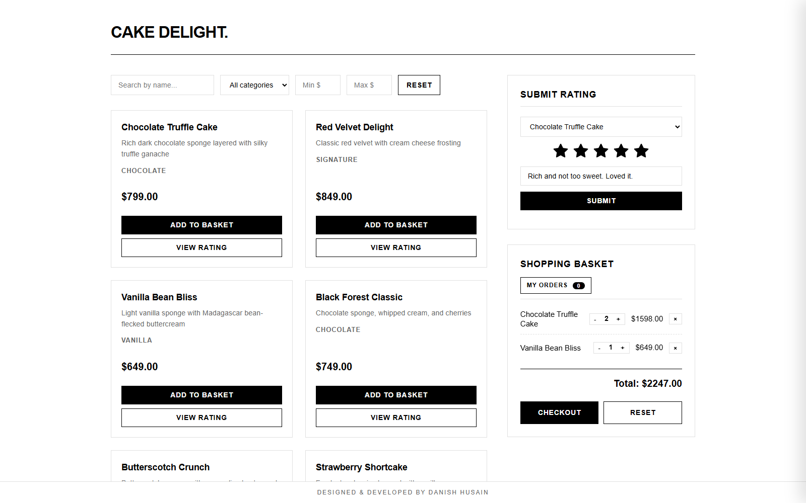

   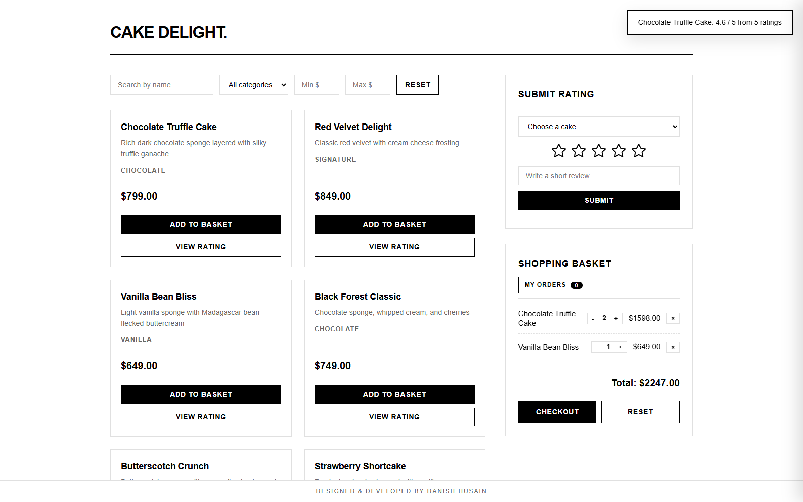

5. **Check out.** Click **Checkout**. order-service marks the order `COMPLETED` and publishes an `OrderCompletedEvent` to RabbitMQ.

   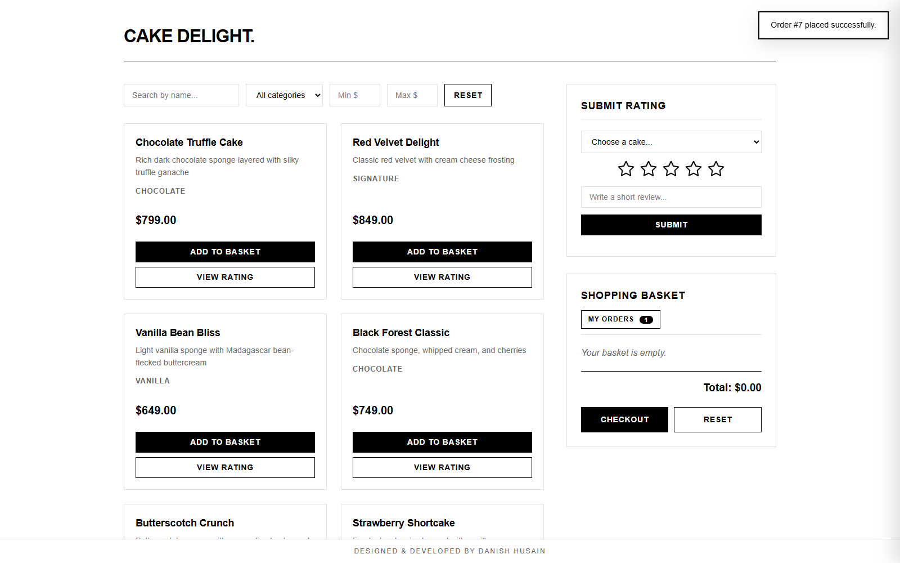

6. **Receive the confirmation.** A moment later notification-service has consumed the event and created the confirmation. The page picks it up and shows it.

   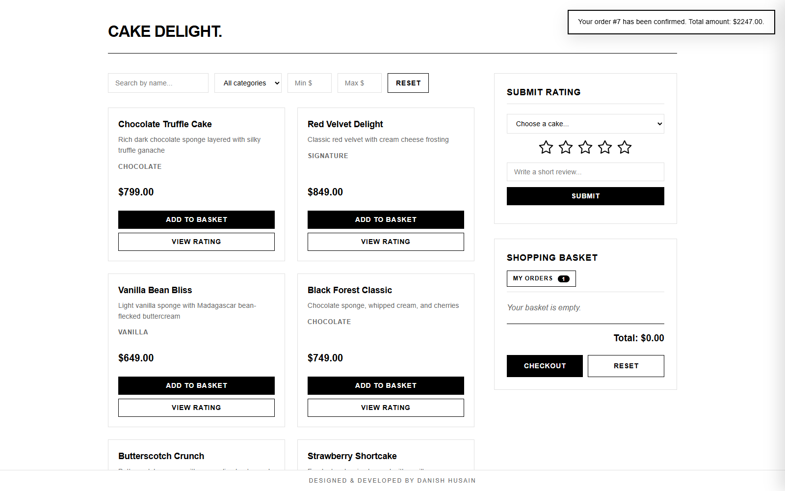

7. **Open My Orders.** The drawer lists the orders placed in this browser session, with their items, totals and confirmation status.

   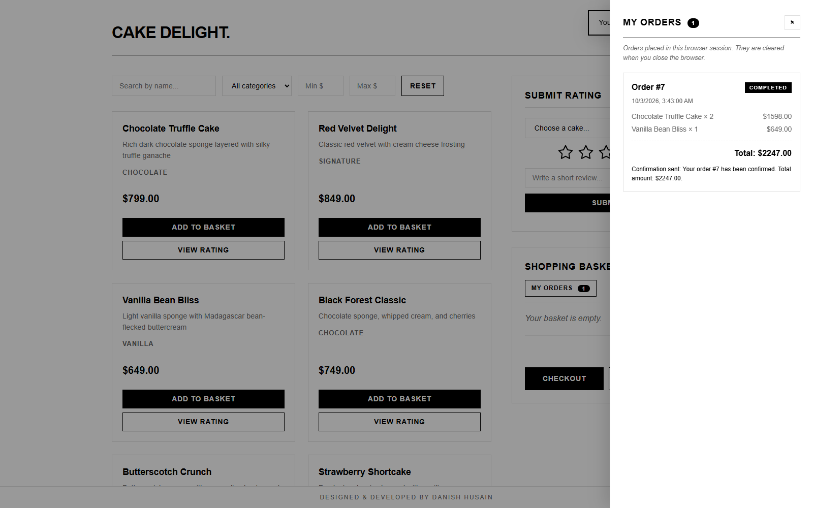

8. **Look behind the scenes (optional).**
    - Eureka dashboard: all five application services registered.
    - RabbitMQ management UI, **Queues** tab: `order_completion_queue` with its message rate, and an empty `order_completion_queue.dlq`.
    - The confirmation through the API: `curl http://localhost:30080/api/notifications`
    - The database (see [Monitoring and operations](#monitoring-and-operations)):

      ```sql
      SELECT * FROM cakedelight_notification.notification_record ORDER BY id DESC LIMIT 5;
      ```

---

## Tests

Every service has its own tests, which run without MySQL, RabbitMQ or Eureka (an in-memory H2 database replaces MySQL and the other dependencies are disabled or mocked):

- **Unit tests** for the business rules: prices taken from the catalog, unavailable and unknown cakes, merging repeated items, empty and repeated checkouts, rating validation and averages, duplicate event handling.
- **Web layer tests** (`@WebMvcTest`) for request validation and the mapping of errors to HTTP status codes.
- **Application tests** (`@SpringBootTest`) that start the whole service and round-trip data through JPA.

Run the tests of one service with Java 21 installed:

```bash
cd order-service
./mvnw verify            # on Windows: mvnw.cmd verify
```

The Dockerfiles skip the tests to keep image builds fast; run `verify` before building images when you change code.

---

## Monitoring and operations

**Health and metrics.** Every Spring Boot service exposes Spring Boot Actuator endpoints. Kubernetes uses the liveness and readiness groups for its probes.

| Endpoint | Purpose |
|---|---|
| `/actuator/health` | Overall health, including database and broker connectivity |
| `/actuator/health/liveness` | Used by the Kubernetes liveness and startup probes |
| `/actuator/health/readiness` | Used by the Kubernetes readiness probe |
| `/actuator/metrics` | JVM, HTTP and connection pool metrics |

Through the gateway: `curl http://localhost:30080/actuator/health`. For a backend service on Kubernetes, port-forward it first, for example `kubectl port-forward deploy/order-service 8082:8082` and then `curl http://localhost:8082/actuator/health`.

**Logs.**

```bash
docker compose logs -f notification-service      # Docker Compose
kubectl logs -f deploy/notification-service       # Kubernetes
```

**Database.** Connect any MySQL client (MySQL Workbench, DBeaver or the `mysql` command line) to `localhost:3307` with user `root` and password `root`. On Kubernetes, run `kubectl port-forward svc/mysql-service 3307:3306` first. Port 3307 is used so that it does not clash with a MySQL server already installed on your machine. The four databases are described in [docs/DATABASE-SCHEMA.md](docs/DATABASE-SCHEMA.md).

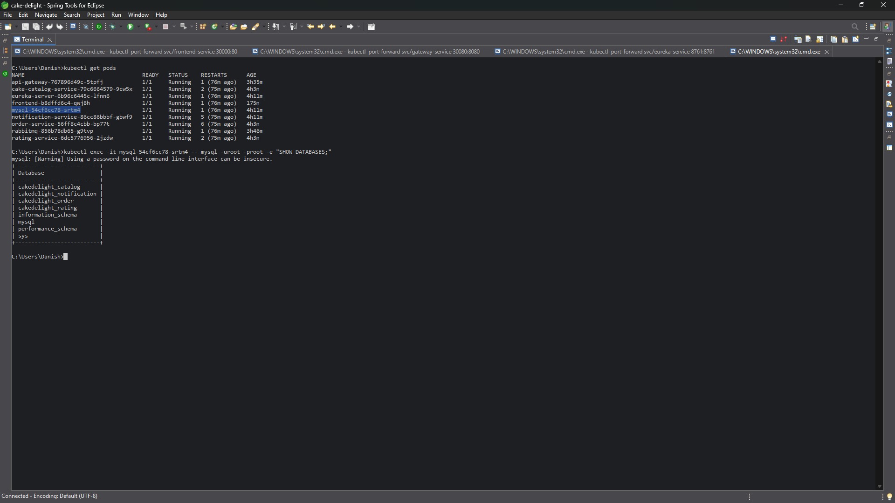

---

## Autoscaling

`k8s/catalog-hpa.yaml` and `k8s/order-hpa.yaml` define HorizontalPodAutoscalers that scale cake-catalog-service and order-service between one and three pods, aiming for 70% of the requested CPU.

The autoscaler needs the Kubernetes Metrics Server, which Docker Desktop does not include. Install it:

```bash
kubectl apply -f https://github.com/kubernetes-sigs/metrics-server/releases/latest/download/components.yaml
```

Docker Desktop's kubelet uses a self-signed certificate that the Metrics Server rejects by default. For a local cluster, allow it with the patch in `k8s/addons`:

```bash
kubectl patch deployment metrics-server -n kube-system --type=json --patch-file=k8s/addons/metrics-server-patch.json
```

After a minute, `kubectl top pods` prints CPU and memory figures.

To watch the autoscaler react, generate load on the catalog:

```bash
kubectl run load-generator --image=busybox --restart=Never -- /bin/sh -c "while true; do wget -q -O- http://cake-catalog-service:8081/api/catalog; done"
```

In a second terminal:

```bash
kubectl get hpa -w
```

Within a minute or two `TARGETS` rises above 70% and `REPLICAS` grows towards 3. Stop the load with `kubectl delete pod load-generator`; the replicas scale back to 1 after a cool-down period.

---

## Troubleshooting

| Symptom | Likely cause | What to do |
|---|---|---|
| The website shows "Cannot reach the API Gateway" | The gateway is not reachable on port 30080 | Docker Compose: wait until `curl http://localhost:30080/api/catalog` works. Kubernetes: check that the gateway port-forward is running |
| An API call returns `503` shortly after startup | The target service has not registered with Eureka yet | Wait a minute; the gateway refreshes its view of the registry every 5 seconds |
| The first requests after startup take several seconds | The JVMs are still loading classes and compiling code | Normal on a laptop; requests become fast after the first few calls |
| Containers or pods restart repeatedly, or everything is very slow | Docker Desktop does not have enough memory | Increase the memory in Docker Desktop (Settings, Resources) and restart the stack |
| Pod in `CrashLoopBackOff` | The application fails at startup | `kubectl logs <pod> --previous` shows the error of the last attempt |
| Pod in `ImagePullBackOff` | The image name or tag does not exist, or the repository is private | `kubectl describe pod <pod>` and check the `images:` section of `k8s/kustomization.yaml` |
| Pod stays `Pending` | Not enough CPU or memory on the node, or the MySQL volume cannot be bound | `kubectl describe pod <pod>` shows the reason under `Events` |
| A port is already in use | Another program uses 30000, 30080, 8761, 15672 or 3307 | Stop that program, or change the published port in `docker-compose.yml` or the port-forward command |
| No confirmation appears after checkout | notification-service or RabbitMQ is not running | Check `docker compose logs notification-service` or `kubectl logs deploy/notification-service`, and look for messages in `order_completion_queue.dlq` in the RabbitMQ UI |
| `PRECONDITION_FAILED` for `order_completion_queue` in the logs | The queue was created by an older version with different arguments | Delete the queue in the RabbitMQ UI (or restart RabbitMQ) so it is declared again |

`kubectl describe pod <pod>` (the `Events` section) and `kubectl logs <pod>` are the first two commands to run for almost any Kubernetes problem.

---

## Design decisions and limitations

- **Database per service on one MySQL server.** Each service has its own database and connects only to it. A single MySQL server keeps the local setup light; in production each service would usually have its own database server.
- **The basket is a `PENDING` order.** This keeps all basket and order logic in one service. A basket that is reset in the UI is simply abandoned, like an abandoned shopping cart.
- **No user accounts.** Authentication is outside the scope of the problem statement. "My Orders" therefore lists the orders placed in the current browser session.
- **Checkout and the event.** The order is saved and flushed before the event is published, and a publishing failure rolls the checkout back. In the rare case that the database commit fails after the event was sent, the consumer would see an event for an order that does not exist. The transactional outbox pattern would close this gap.
- **Schema management.** Hibernate creates and updates the tables (`ddl-auto=update`), which suits a project of this size. A production system would use versioned migrations with Flyway or Liquibase.
- **Credentials and CORS.** The credentials in `k8s/secrets.yaml` and `docker-compose.yml` are local development values, and the gateway allows requests from any origin. Both would be locked down for a real deployment.
- **Notification channel.** Confirmations are delivered in-app. Email or SMS would be added as further channels in notification-service.

---

## Further documentation

- [API documentation](docs/API-DOCUMENTATION.md): every endpoint, request and response, error codes, and Swagger UI
- [Database schema](docs/DATABASE-SCHEMA.md): the tables of each service and how they relate
- [Event contract](docs/EVENT-CONTRACT.md): the RabbitMQ topology and the order completion event

---

## License

Released under the [MIT License](LICENSE).
