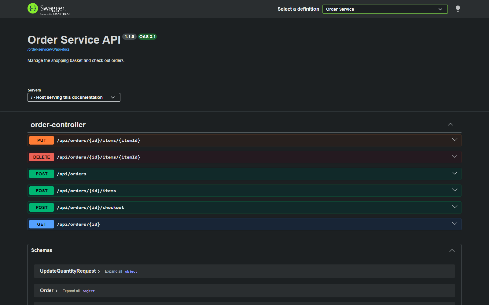

# API Documentation

Clients call every endpoint **through the API Gateway**. The gateway routes each request by path to the service that owns it:

| Path prefix | Service |
|---|---|
| `/api/catalog/**` | cake-catalog-service |
| `/api/orders/**` | order-service |
| `/api/ratings/**` | rating-service |
| `/api/notifications/**` | notification-service |

**Base URL:** `http://localhost:30080`

The same base URL works for Docker Compose and for Kubernetes (with the port-forward or `LoadBalancer` setup described in the [README](../README.md#35-access-the-application)).

All request and response bodies are JSON. Money values (`price`, `totalAmount`, `lineTotal`) are decimal numbers with two decimal places.

---

## 1. Cake Catalog Service

### Endpoints

| Method | Endpoint | Description | Success | Errors |
|---|---|---|---|---|
| `GET` | `/api/catalog` | List cakes. Optional query parameters, which can be combined: `name` (partial, case-insensitive), `category` (exact, case-insensitive), `minPrice`, `maxPrice` | `200` array of Cake | `400` negative or inverted price range |
| `GET` | `/api/catalog/{id}` | Get one cake | `200` Cake | `404` unknown id, `400` non-numeric id |
| `GET` | `/api/catalog/search?name={name}` | Cakes whose name contains `name` | `200` array of Cake | `400` missing `name` |
| `GET` | `/api/catalog/category/{category}` | Cakes in a category | `200` array of Cake | |
| `GET` | `/api/catalog/price?min={min}&max={max}` | Cakes in a price range (inclusive) | `200` array of Cake | `400` missing parameter or `min > max` |
| `POST` | `/api/catalog` | Add a cake | `201` Cake, with a `Location` header | `400` validation error, `409` name already exists |

The `search`, `category` and `price` endpoints filter on one attribute each. `GET /api/catalog` with query parameters filters on any combination, and is what the frontend uses.

Examples:

```bash
curl "http://localhost:30080/api/catalog?category=Chocolate&maxPrice=780"
curl "http://localhost:30080/api/catalog?name=velvet"
```

### Cake

```json
{
  "id": 1,
  "name": "Chocolate Truffle Cake",
  "description": "Rich dark chocolate sponge layered with silky truffle ganache",
  "category": "Chocolate",
  "price": 799.00,
  "availability": true,
  "imageReference": "chocolate-truffle.jpg"
}
```

Validation on `POST /api/catalog`:

| Field | Rule |
|---|---|
| `name` | required, at most 100 characters, unique |
| `category` | required, at most 50 characters |
| `price` | required, zero or positive, at most 2 decimal places |
| `availability` | optional, defaults to `true` |
| `description`, `imageReference` | optional, at most 255 characters |

`id` is always generated by the database; an `id` in the request body is ignored.

---

## 2. Order Service

An order is a **basket** while its `status` is `PENDING`. Checkout changes the status to `COMPLETED`, after which the order can no longer be changed.

The client only sends a cake id and a quantity. order-service looks up the cake's name, price and availability from cake-catalog-service (a synchronous REST call through Eureka, with retries) and stores them on the order line. Totals are always calculated on the server.

### Endpoints

| Method | Endpoint | Description | Request body | Success | Errors |
|---|---|---|---|---|---|
| `POST` | `/api/orders` | Create a basket, optionally with items | none, or `{"items": [AddItem, ...]}` | `201` Order (`PENDING`) | `400`, `409`, `503` as for adding an item |
| `GET` | `/api/orders/{id}` | Get a basket or order | | `200` Order | `404` |
| `POST` | `/api/orders/{id}/items` | Add a cake. Adding a cake that is already in the basket increases its quantity | AddItem | `200` Order | `400` invalid body or unknown cake, `404` unknown order, `409` order completed or cake unavailable, `503` catalog unreachable |
| `PUT` | `/api/orders/{id}/items/{itemId}` | Change the quantity of a line | `{"quantity": 3}` | `200` Order | `400` quantity outside 1 to 99, `404` unknown order or item, `409` order completed |
| `DELETE` | `/api/orders/{id}/items/{itemId}` | Remove a line | | `200` Order | `404` unknown order or item, `409` order completed |
| `POST` | `/api/orders/{id}/checkout` | Complete the order | | `200` Order (`COMPLETED`) | `404` unknown order, `409` already completed or basket empty, `503` message broker unreachable (the order stays `PENDING`) |

### AddItem

```json
{
  "cakeId": 3,
  "quantity": 1
}
```

`cakeId` is required. `quantity` is required and must be between 1 and 99.

### Order

```json
{
  "id": 17,
  "status": "COMPLETED",
  "totalAmount": 2247.00,
  "createdAt": "2026-10-02T20:37:42.805Z",
  "completedAt": "2026-10-02T20:37:50.090Z",
  "items": [
    {
      "id": 1,
      "cakeId": 1,
      "cakeName": "Chocolate Truffle Cake",
      "price": 799.00,
      "quantity": 2,
      "lineTotal": 1598.00
    },
    {
      "id": 2,
      "cakeId": 3,
      "cakeName": "Vanilla Bean Bliss",
      "price": 649.00,
      "quantity": 1,
      "lineTotal": 649.00
    }
  ]
}
```

### Side effect of checkout

A successful checkout publishes an `OrderCompletedEvent` to RabbitMQ. notification-service consumes it asynchronously and creates the order confirmation, so the checkout response does not wait for the notification. See [EVENT-CONTRACT.md](EVENT-CONTRACT.md).

---

## 3. Rating Service

### Endpoints

| Method | Endpoint | Description | Success | Errors |
|---|---|---|---|---|
| `POST` | `/api/ratings` | Submit a rating | `201` Rating | `400` invalid body or unknown cake, `503` catalog unreachable |
| `GET` | `/api/ratings/cake/{cakeId}` | All ratings for a cake, newest first | `200` array of Rating | |
| `GET` | `/api/ratings/cake/{cakeId}/average` | Average score and number of ratings | `200` RatingSummary | |

Before saving a rating, rating-service checks with cake-catalog-service that the cake exists.

### Submit request

```json
{
  "cakeId": 2,
  "score": 5,
  "reviewText": "Best red velvet I have had."
}
```

`cakeId` is required. `score` is required and must be between 1 and 5. `reviewText` is optional, at most 500 characters.

### Rating

```json
{
  "id": 1,
  "cakeId": 2,
  "score": 5,
  "reviewText": "Best red velvet I have had.",
  "createdAt": "2026-10-02T20:38:10.093Z"
}
```

### RatingSummary

```json
{
  "cakeId": 2,
  "averageScore": 4.5,
  "ratingCount": 2
}
```

`averageScore` is rounded to two decimals, and is `0.0` when `ratingCount` is `0`.

---

## 4. Notification Service

notification-service is driven by the order-completion event (see [EVENT-CONTRACT.md](EVENT-CONTRACT.md)). Its REST API is read-only and lets the frontend show the customer their order confirmation (an in-app notification).

| Method | Endpoint | Description | Success |
|---|---|---|---|
| `GET` | `/api/notifications` | The 50 most recent notifications, newest first | `200` array of Notification |
| `GET` | `/api/notifications/order/{orderId}` | Notifications for one order. Empty until the event has been processed | `200` array of Notification |

### Notification

```json
{
  "id": 1,
  "orderId": 17,
  "message": "Your order #17 has been confirmed. Total amount: $2247.00.",
  "status": "SENT",
  "createdAt": "2026-10-02T20:38:00.677Z"
}
```

`status` is `SENT`, or `FAILED` for an attempt that failed (see the retry behaviour in [EVENT-CONTRACT.md](EVENT-CONTRACT.md)).

---

## 5. Errors

Every service returns errors in the same shape:

```json
{
  "timestamp": "2026-10-02T20:37:49.217Z",
  "status": 409,
  "error": "Conflict",
  "message": "Coffee Walnut Cake is currently unavailable",
  "path": "/api/orders/1/items"
}
```

| Status | Meaning |
|---|---|
| `400 Bad Request` | Invalid body or parameter. For validation errors, `message` lists each failing field, for example `"score: score must be at most 5"` |
| `404 Not Found` | The resource or path does not exist |
| `409 Conflict` | The request is valid but conflicts with the current state, for example changing a completed order |
| `503 Service Unavailable` | A service or the message broker that this request depends on is unreachable. Calls to other services are retried before giving up |
| `500 Internal Server Error` | Unexpected error. Details are logged on the server, never returned to the client |

If a backend service is down entirely, the gateway itself answers with `503`.

---

## 6. Swagger UI

Each service generates an OpenAPI description from its controllers with springdoc-openapi, so the interactive documentation always matches the code. The gateway serves one Swagger UI for all four services:

```
http://localhost:30080/swagger-ui.html
```



Use **Select a definition** in the top right corner to switch between the Cake Catalog, Order, Rating and Notification services. Expand an endpoint, click **Try it out**, fill in the parameters and click **Execute** to send a real request through the gateway.

The raw OpenAPI documents are also available through the gateway:

```
http://localhost:30080/cake-catalog-service/v3/api-docs
http://localhost:30080/order-service/v3/api-docs
http://localhost:30080/rating-service/v3/api-docs
http://localhost:30080/notification-service/v3/api-docs
```
