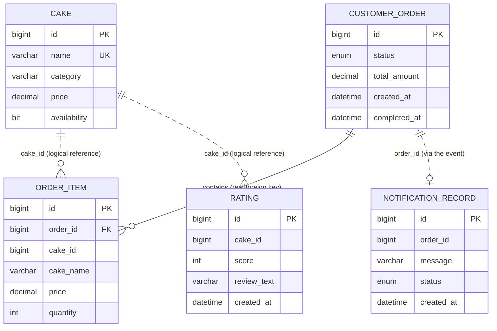

# Database Schema

## Database per service

Each service owns its data. All four databases live on one MySQL server (to keep the local setup light), but every service connects only to its own database and never reads or writes another service's tables. Data that belongs to another service is reached through that service's API or through the order completion event, never through a shared table.

| Service | Database | Tables |
|---|---|---|
| cake-catalog-service | `cakedelight_catalog` | `cake` |
| order-service | `cakedelight_order` | `customer_order`, `order_item` |
| rating-service | `cakedelight_rating` | `rating` |
| notification-service | `cakedelight_notification` | `notification_record` |

Each database is created on first connection (`createDatabaseIfNotExist=true` in the JDBC URL), and Hibernate creates and updates the tables from the JPA entities (`spring.jpa.hibernate.ddl-auto=update`). No manual setup is needed. cake-catalog-service inserts eight sample cakes when its table is empty.

To look at the data, connect a MySQL client to `localhost:3307` (user `root`, password `root`); on Kubernetes run `kubectl port-forward svc/mysql-service 3307:3306` first.

```
mysql> SHOW DATABASES LIKE 'cakedelight%';
+--------------------------+
| Database (cakedelight%)  |
+--------------------------+
| cakedelight_catalog      |
| cakedelight_notification |
| cakedelight_order        |
| cakedelight_rating       |
+--------------------------+
```

## Data model



Solid lines are foreign keys inside one database. Dotted lines are references across databases: they hold the id of a record owned by another service and are checked by the application (order-service and rating-service ask cake-catalog-service whether a cake exists), not by a database constraint.

---

## 1. cake-catalog-service: `cakedelight_catalog`

### `cake`

```
mysql> DESCRIBE cake;
+-----------------+---------------+------+-----+---------+----------------+
| Field           | Type          | Null | Key | Default | Extra          |
+-----------------+---------------+------+-----+---------+----------------+
| id              | bigint        | NO   | PRI | NULL    | auto_increment |
| availability    | bit(1)        | NO   |     | NULL    |                |
| category        | varchar(50)   | NO   |     | NULL    |                |
| description     | varchar(255)  | YES  |     | NULL    |                |
| image_reference | varchar(255)  | YES  |     | NULL    |                |
| name            | varchar(100)  | NO   | UNI | NULL    |                |
| price           | decimal(10,2) | NO   |     | NULL    |                |
+-----------------+---------------+------+-----+---------+----------------+
```

| Column | Notes |
|---|---|
| `id` | Primary key, generated by the database |
| `name` | Required, unique, at most 100 characters |
| `description` | Optional |
| `category` | Required, at most 50 characters |
| `price` | Required, `DECIMAL(10,2)`, zero or positive |
| `availability` | Required. Unavailable cakes are shown but cannot be ordered |
| `image_reference` | File name of the cake's image. No binary image data is stored |

---

## 2. order-service: `cakedelight_order`

### `customer_order`

The table is called `customer_order` because `ORDER` is a reserved SQL word.

```
mysql> DESCRIBE customer_order;
+--------------+-----------------------------+------+-----+---------+----------------+
| Field        | Type                        | Null | Key | Default | Extra          |
+--------------+-----------------------------+------+-----+---------+----------------+
| id           | bigint                      | NO   | PRI | NULL    | auto_increment |
| completed_at | datetime(6)                 | YES  |     | NULL    |                |
| created_at   | datetime(6)                 | NO   |     | NULL    |                |
| status       | enum('COMPLETED','PENDING') | NO   |     | NULL    |                |
| total_amount | decimal(12,2)               | NO   |     | NULL    |                |
+--------------+-----------------------------+------+-----+---------+----------------+
```

| Column | Notes |
|---|---|
| `id` | Primary key |
| `status` | `PENDING` while the order is an editable basket, `COMPLETED` after checkout |
| `total_amount` | Sum of the line totals, recalculated by the service on every change |
| `created_at` | When the basket was created |
| `completed_at` | When the order was checked out; empty while `PENDING` |

### `order_item`

```
mysql> DESCRIBE order_item;
+-----------+---------------+------+-----+---------+----------------+
| Field     | Type          | Null | Key | Default | Extra          |
+-----------+---------------+------+-----+---------+----------------+
| id        | bigint        | NO   | PRI | NULL    | auto_increment |
| cake_id   | bigint        | NO   |     | NULL    |                |
| cake_name | varchar(100)  | NO   |     | NULL    |                |
| price     | decimal(10,2) | NO   |     | NULL    |                |
| quantity  | int           | NO   |     | NULL    |                |
| order_id  | bigint        | YES  | MUL | NULL    |                |
+-----------+---------------+------+-----+---------+----------------+
```

| Column | Notes |
|---|---|
| `id` | Primary key |
| `order_id` | Foreign key to `customer_order.id`. Removing an item from the basket deletes its row |
| `cake_id` | Id of the cake in cake-catalog-service (logical reference, see above) |
| `cake_name`, `price` | Copied from the catalog when the item is added, so a completed order keeps the name and price the customer actually paid, even if the catalog changes later |
| `quantity` | 1 to 99 |

---

## 3. rating-service: `cakedelight_rating`

### `rating`

```
mysql> DESCRIBE rating;
+-------------+--------------+------+-----+---------+----------------+
| Field       | Type         | Null | Key | Default | Extra          |
+-------------+--------------+------+-----+---------+----------------+
| id          | bigint       | NO   | PRI | NULL    | auto_increment |
| cake_id     | bigint       | NO   | MUL | NULL    |                |
| created_at  | datetime(6)  | NO   |     | NULL    |                |
| review_text | varchar(500) | YES  |     | NULL    |                |
| score       | int          | NO   |     | NULL    |                |
+-------------+--------------+------+-----+---------+----------------+
```

| Column | Notes |
|---|---|
| `id` | Primary key |
| `cake_id` | Id of the rated cake (logical reference). Indexed, because ratings are always looked up by cake |
| `score` | 1 to 5. Enforced by request validation and by a database `CHECK` constraint |
| `review_text` | Optional, at most 500 characters |
| `created_at` | When the rating was submitted |

The average score shown in the UI is calculated by the database (`AVG(score)`) on request, so it is always current.

---

## 4. notification-service: `cakedelight_notification`

### `notification_record`

```
mysql> DESCRIBE notification_record;
+------------+-----------------------+------+-----+---------+----------------+
| Field      | Type                  | Null | Key | Default | Extra          |
+------------+-----------------------+------+-----+---------+----------------+
| id         | bigint                | NO   | PRI | NULL    | auto_increment |
| created_at | datetime(6)           | NO   |     | NULL    |                |
| message    | varchar(500)          | NO   |     | NULL    |                |
| order_id   | bigint                | NO   | MUL | NULL    |                |
| status     | enum('FAILED','SENT') | NO   |     | NULL    |                |
+------------+-----------------------+------+-----+---------+----------------+
```

| Column | Notes |
|---|---|
| `id` | Primary key |
| `order_id` | Id of the order the confirmation belongs to (logical reference). Indexed |
| `message` | The confirmation text shown to the customer, or the error for a failed attempt |
| `status` | `SENT` or `FAILED` |
| `created_at` | When the record was written |

Rows are written only by the RabbitMQ listener (see [EVENT-CONTRACT.md](EVENT-CONTRACT.md)) and read through `GET /api/notifications`. Before writing a `SENT` row, the service checks that the order has none yet, so a redelivered event never produces a second confirmation.

Example after a checkout:

```
mysql> SELECT order_id, status, message FROM cakedelight_notification.notification_record;
+----------+--------+-----------------------------------------------------------+
| order_id | status | message                                                   |
+----------+--------+-----------------------------------------------------------+
|        7 | SENT   | Your order #7 has been confirmed. Total amount: $2247.00. |
+----------+--------+-----------------------------------------------------------+
```
