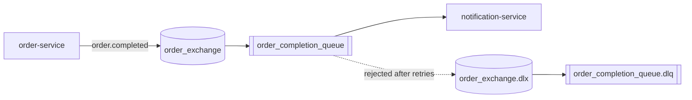

# Event Contract: Order Completion

This document defines the asynchronous contract between **order-service** (publisher) and **notification-service** (consumer). For the REST contracts, see [API-DOCUMENTATION.md](API-DOCUMENTATION.md).

## Why an event

Completing an order and confirming it to the customer are separate concerns. If order-service called notification-service directly, a slow or unavailable notification-service would slow down or break checkout. Instead, order-service publishes an event describing what happened and returns immediately. notification-service processes the event whenever it is ready. RabbitMQ keeps the message until then, so a notification-service restart does not lose confirmations.

## Actors

| Role | Component | Responsibility |
|---|---|---|
| Publisher | order-service | Publishes one event when an order becomes `COMPLETED` |
| Broker | RabbitMQ | Routes the event to the queue and stores it until it is acknowledged |
| Consumer | notification-service | Creates the order confirmation and records its delivery status |

## Broker topology

| Component | Name | Type | Durable |
|---|---|---|---|
| Exchange | `order_exchange` | direct | yes |
| Queue | `order_completion_queue` | classic | yes |
| Routing key | `order.completed` | | |
| Dead-letter exchange | `order_exchange.dlx` | direct | yes |
| Dead-letter queue | `order_completion_queue.dlq` | classic | yes |
| Dead-letter routing key | `order.completed.dead` | | |

`order_completion_queue` is bound to `order_exchange` with the key `order.completed`, and declared with these arguments:

| Argument | Value |
|---|---|
| `x-dead-letter-exchange` | `order_exchange.dlx` |
| `x-dead-letter-routing-key` | `order.completed.dead` |

Both services declare the complete topology on startup (`RabbitMQConfig` in each service). Declarations are idempotent, so whichever service starts first creates it, and no event is lost if the consumer starts after the publisher. The queue arguments must be identical in both services; RabbitMQ rejects a declaration that differs from an existing queue.



## When the event is published

Exactly once per order, when `OrderService.checkout()` changes the order from `PENDING` to `COMPLETED`. The order is saved and flushed to the database first and the event is published afterwards, inside the same transaction. If publishing fails (for example because RabbitMQ is down), the transaction is rolled back, the order stays `PENDING` and the checkout returns `503 Service Unavailable`, so the client can safely retry.

No event is published when a basket is created or changed, or when checkout is rejected (for example a second checkout of the same order, or an empty basket).

## Payload: `OrderCompletedEvent`

```json
{
  "orderId": 17,
  "totalAmount": 2247.00,
  "status": "COMPLETED",
  "completedAt": "2026-10-02T20:37:50.090537753Z"
}
```

| Field | Type | Description |
|---|---|---|
| `orderId` | number (Long) | Id of the completed order. Required |
| `totalAmount` | number (decimal) | Order total at checkout |
| `status` | string | Always `COMPLETED` for this event |
| `completedAt` | string (ISO-8601 instant) | When the order was completed |

**Format:** JSON, written and read by Spring AMQP's `JacksonJsonMessageConverter` (registered in both services). The message also carries the standard `__TypeId__` header with the publisher's class name; the consumer ignores it and maps the JSON onto its own class, chosen from the `@RabbitListener` method parameter.

**Two copies of the class:** each service has its own `OrderCompletedEvent` record. The services do not share a library, so the JSON field names are the contract. When a field is added, renamed or removed, change both copies, or the consumer receives `null` for that field.

## What the consumer does

`OrderEventListener` in notification-service listens on `order_completion_queue`. For each message it:

1. Rejects messages without an `orderId` straight to the dead-letter queue, because retrying cannot fix them.
2. Checks whether a `SENT` confirmation already exists for the order. If it does, the message is a duplicate and is acknowledged without creating a second confirmation.
3. Otherwise saves a `notification_record` row with `status = SENT` and the confirmation text.

The confirmation is delivered **in-app**: the frontend reads it through `GET /api/notifications/order/{orderId}` and shows it to the customer. An email or SMS provider could be added as a further delivery channel in `NotificationService`.

## Failures and retries

If processing throws an exception:

1. The listener records a `FAILED` row for the order (when the database is reachable) and rethrows.
2. The listener container retries the message: 3 attempts in total, 1 second and then 2 seconds apart.
3. If the last attempt also fails, the message is rejected without requeueing, and RabbitMQ moves it to `order_completion_queue.dlq`.

Messages in the dead-letter queue can be inspected in the RabbitMQ management UI and moved back to the main queue once the cause has been fixed. Without the dead-letter queue, a message that always fails would be redelivered in an endless loop.

## Delivery guarantees

The broker delivers **at least once**: a message stays in the queue until the consumer acknowledges it, so it can be delivered again if the consumer stops after processing but before acknowledging. The duplicate check in step 2 above makes this safe; a repeated event never creates a second confirmation.

## Possible extensions

- Use the transactional outbox pattern, so that saving the order and publishing the event can never get out of step, even if the database commit fails after the message was sent.
- Publish the contract as a JSON Schema (or move the event class into a shared contract module) if more consumers are added.
- Add email or SMS as further delivery channels.
